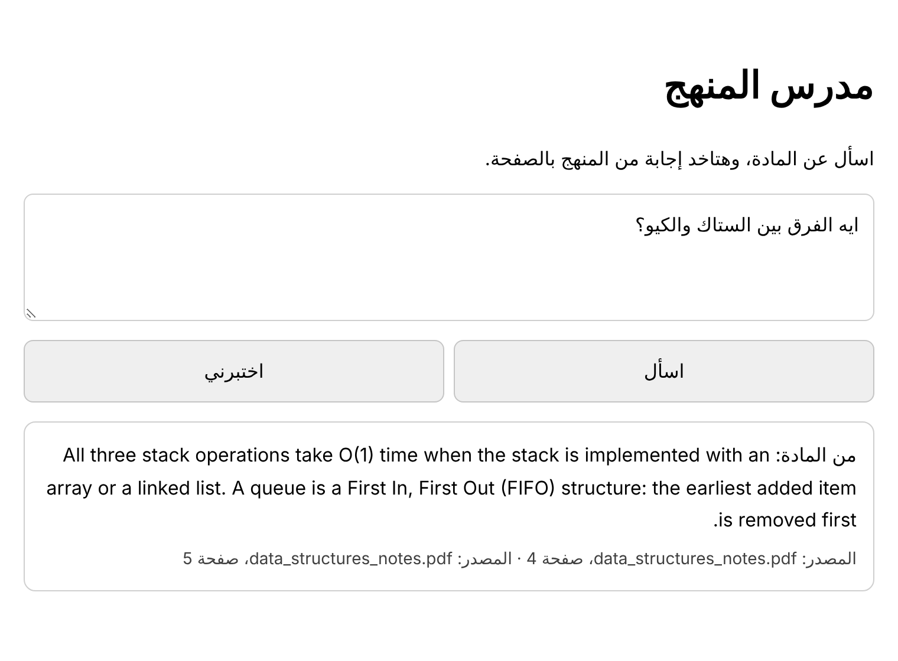

# Course Tutor RAG

An AI tutor that answers students only from their course material. It cites the source page and declines when the course doesn't cover the question.

<p align="center"></p>

## The problem

Many Arabic-speaking CS students study from English notes but think through questions in Arabic. General chatbots answer anyway, even when the answer isn't in their course. This project keeps answers tied to the material, so a student can check every one.

## What it does

- Takes questions in English, Arabic, or Egyptian Arabic, and searches English course PDFs
- Returns the source file and page with each answer
- Declines off-topic questions instead of guessing
- Creates fill-in-the-blank review questions from the material
- Runs without an API key in citation-only mode; adding a Gemini key turns on written explanations

## How it works

```
Course PDF -> page-aware chunks
Question -> Arabic normalization and course-term mapping
         -> BM25 + character n-grams (optional embeddings)
         -> Reciprocal Rank Fusion -> rerank by term coverage and phrases
         -> coverage check -> answer with citations, or decline
```

With Gemini on, an answer with no valid citation is discarded and replaced by a direct quote from the course.

## Evaluation

The questions and labels are in `eval/questions.py`. Run `python -m eval.run_eval`. Full output: `eval/results.json`.

| Metric | Plain BM25 (test) | This system (test) | This system (dev) |
|---|---|---|---|
| Correct page first (Hit@1) | 61.9% | 100% (21/21) | 91.3% (21/23) |
| Correct page in top 3 (Hit@3) | 61.9% | 100% (21/21) | 95.7% (22/23) |
| Off-topic questions declined | not measured | 9/9 | 8/8 |
| Valid questions wrongly declined | not measured | 1/21 | 0/23 |

**How to read these numbers:** the test set is small, I wrote it myself, and the course is an 8-page sample. Its score was also rerun after a bug fix found while trying a comparison question. Treat this as a regression check, not proof of real-world accuracy. Real student questions would be the next test.

Only retrieval and refusal were measured. Gemini answer quality has not been evaluated, so RAGAS is the next step.

## Known limitations

- Arabic search depends on a hand-written term list. Unlisted spellings, such as "المرج سورت", can be wrongly declined.
- Abbreviations that aren't in the course, such as "BST", can be wrongly declined.
- A question mixing a course term with an outside topic, such as "البحث في جوجل", can get an irrelevant answer without Gemini.
- "How does binary search work?" in Arabic can rank the binary search tree page first.
- Without Gemini, Arabic questions get a quote in English.
- Scanned PDFs need OCR first. Arabic PDFs haven't been tested.
- The optional embeddings path has only been tested with a fake embedder.
- The API has no login or rate limiting yet, so add both before a public launch.

## Requirements

- Python 3.12 (the Docker image's version; also tested on 3.13)
- Packages in `requirements.txt`: FastAPI, Uvicorn, httpx, pypdf, scikit-learn, NumPy (version ranges pinned there)
- Optional: a free Gemini API key from [Google AI Studio](https://aistudio.google.com/apikey) for written explanations
- Text-based PDFs for your course (scanned PDFs need OCR first)

## Run it

```bash
python -m venv .venv
source .venv/bin/activate        # Windows: .venv\Scripts\activate
pip install -r requirements-dev.txt
uvicorn app.api:app --reload
```

Open http://localhost:8000, type a question in Arabic or English, then press **اسأل** (ask) or **اختبرني** (quiz me).

To use your own course, put text-based PDFs in `course/`, and only use material you have the right to use. The included notes are original samples.

## Environment variables

All are optional. The app reads them from the environment; it does not load `.env` by itself.

| Variable | Default | What it does |
|---|---|---|
| `GEMINI_API_KEY` | empty | Turns on written explanations. Without it, answers are direct quotes with citations |
| `GEMINI_MODEL` | `gemini-2.5-flash` | Gemini model used for explanations |
| `COURSE_DIR` | `course/` | Folder of course PDFs to index |
| `MIN_COVERAGE` | `0.45` | How much of the question the material must cover before the tutor answers instead of declining |

Set a key for the current terminal session:

```bash
export GEMINI_API_KEY=your_key            # macOS/Linux
$env:GEMINI_API_KEY="your_key"            # Windows PowerShell
```

Never commit a real key. `.env` is git-ignored.

## API

| Method | Path | Body | Returns |
|---|---|---|---|
| `GET` | `/health` | none | Status, number of indexed chunks, and whether Gemini is on |
| `POST` | `/ask` | `{"question": "..."}` (max 500 chars) | Answer, `grounded` flag, mode, and citations |
| `POST` | `/quiz` | `{"topic": "...", "count": 1-5}` | Fill-in-the-blank questions with options and page |

Interactive docs: http://localhost:8000/docs

```bash
curl -X POST http://localhost:8000/ask -H "Content-Type: application/json" \
     -d '{"question": "What is a stack?"}'
```

```json
{
  "answer": "All three stack operations take O(1) time when the stack is implemented with an array or a linked list.",
  "grounded": true,
  "mode": "extractive",
  "citations": [
    {"source": "data_structures_notes.pdf", "page": 4, "heading": "Lecture 4: Stacks", "quote": "All three stack operations take O(1) time..."}
  ]
}
```

## Tests

```bash
pytest                      # 13 offline tests, no API key needed
python -m eval.run_eval     # retrieval and refusal evaluation (see above)
```

### Docker

```bash
docker build -t course-tutor .
docker run -p 8000:8000 -e GEMINI_API_KEY=your_key course-tutor
```

The Docker image hasn't been built and tested yet.

## Project structure

```
app/
  ingest.py     PDF -> page-aware chunks
  textnorm.py   Arabic normalization and course-term mapping
  retrieve.py   hybrid search, fusion and reranking
  tutor.py      answer / decline logic, Gemini client, quiz
  api.py        FastAPI app (/ask, /quiz, /health)
  static/       web UI (Arabic, RTL)
course/         course PDFs to index
eval/           labelled questions and evaluation script
scripts/        generates the sample course PDF
tests/          pytest suite
```

## Stack

Python 3.12, FastAPI, scikit-learn (BM25 + n-gram retrieval), pypdf, Gemini API (optional), pytest, Docker

## License

MIT, see [LICENSE](LICENSE).

---
Built by [Hesham Ashraf](https://www.linkedin.com/in/hesham-ashrf) · AI Engineer (AI agents & automation)
